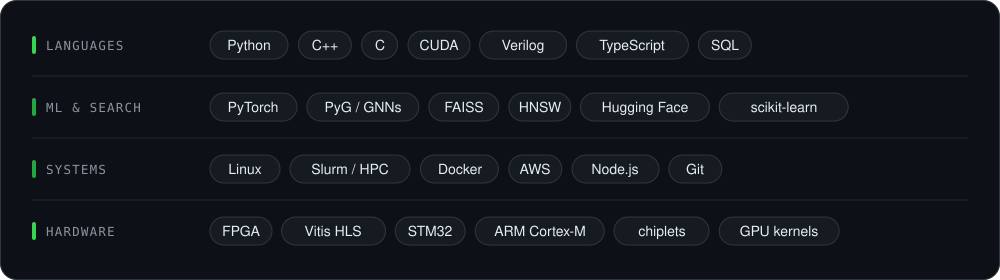

  

  <a href="https://ganaptewary.com"><b>ganaptewary.com</b></a> &nbsp;·&nbsp;
  <a href="#-research">Research</a> &nbsp;·&nbsp;
  <a href="#-projects">Projects</a> &nbsp;·&nbsp;
  <a href="#-toolkit">Toolkit</a>

## 👋 About

I'm a Computer Engineering PhD student at **Arizona State University**.
I work on **approximation algorithms** and **hardware–software co-design across the AI stack**, from
billion-scale vector search and neural architecture search down to GPUs, FPGAs and chiplets.
I also TA Embedded Systems, IoT and Statistics for 80+ students.

  

## 🔬 Research

<table>
<tr>
<td width="50%" valign="top">
<b>⚡ AQR-HNSW</b> &nbsp;<code>DAC 2026</code>  
Adaptive quantization and reranking for <b>billion-scale vector retrieval</b>. Compresses HNSW graph search with adaptive quantization, then reranks in full precision to recover accuracy.  
HNSW · quantization · ANN search · C++
</td>
<td width="50%" valign="top">
<b>🧠 NEXUS-NAS</b>  
GNN-enhanced <b>multi-fidelity neural architecture search</b>. A graph-neural-network surrogate steers the search, so most candidate architectures never need full training.  
NAS · GNNs · surrogate models · PyTorch
</td>
</tr>
</table>

> **MS thesis:** *Scaling Search Across the AI Stack: Adaptive Approximation and Surrogate-Guided Navigation from Billion-Scale Retrieval to Neural Architecture Search*

## 🛠️ Projects

| Project | What it is |
|---|---|
| 🌌 [**NovaComp**](https://github.com/parhitmtech/Nova) | Cloud IDE for **Nova**, a statically typed ML language with built-in tensors, autograd and GPU-cluster training |
| 🧮 **HyperCompute** | Hyperdimensional computing framework: Python algebra → C for STM32 → Verilog for an Alveo U280 FPGA *(in progress)* |
| 🌐 [**ganaptewary.com**](https://github.com/GanapT/AGI_RAG_Model) | Research site and portfolio API (Express, Node.js) |
| 🤖 [**Autonomous Delivery Cart**](https://github.com/GanapT/Autonomous_DeliveryCart) | Line-following robot on a FRDM-KL46Z: PWM motor control and ADC light sensing in bare-metal C |
| ⌚ [**Fitness Tracker Analyzer**](https://github.com/GanapT/Fitness_Tracker_Analyzer) | Step and distance tracker in Verilog on an Artix-7 FPGA |
| 📈 [**ML for Financial Data**](https://github.com/GanapT/MLforFinancialData) | Predictors for stocks, crypto, forex and commodities |

## 🧰 Toolkit

  

Open to research collaborations · reach me through <a href="https://ganaptewary.com">ganaptewary.com</a>

