<!-- ══════════════════════ HEADER ══════════════════════ -->
<p align="center">
  
</p>

<p align="center">
  <a href="https://git.io/typing-svg">
    
  </a>
</p>

<p align="center">
  <a href="https://ganaptewary.com"></a>
  
  
  
</p>

---

## `$ whoami`

```python
class Rich:
    name       = "Ganap Ashit Tewary"
    role       = "PhD student, ECEE @ Arizona State University"
    advisor    = "Prof. Jeff (Jun) Zhang"
    based_in   = "Tempe, AZ 🌵"

    research   = [
        "approximation algorithms",
        "hardware-software co-design across the AI stack",
        "vector search · neural architecture search · chiplets",
    ]
    teaching   = "TA for 80+ students — Embedded Systems, IoT, Statistics"
    motto      = "approximate cleverly, measure everything"
```

---

## 🔬 Research Highlights

<table>
<tr>
<td width="50%" valign="top">

### ⚡ AQR-HNSW
**Adaptive quantization + reranking for billion-scale vector retrieval**
Published at **DAC 2026**. Squeezes HNSW graph search with adaptive
quantization, then reranks to win the accuracy back.

`HNSW` `quantization` `ANN search` `C++`

</td>
<td width="50%" valign="top">

### 🧠 NEXUS-NAS
**GNN-enhanced multi-fidelity neural architecture search**
A graph-neural-network surrogate that steers the search, so most
candidate architectures never need full training.

`NAS` `GNNs` `surrogate models` `PyTorch`

</td>
</tr>
</table>

> 📜 **MS Thesis** — *Scaling Search Across the AI Stack: Adaptive Approximation and Surrogate-Guided Navigation from Billion-Scale Retrieval to Neural Architecture Search*

---

## 🛠️ Things I've Built

| | Project | What it is |
|:-:|---|---|
| 🌌 | [**NovaComp**](https://github.com/parhitmtech/Nova) | Cloud IDE for **Nova**, a statically typed ML language with built-in tensors, autograd and GPU-cluster training — sandboxed runs, a web terminal, and an AI coding assistant |
| 🧮 | **HyperCompute** *(in progress)* | Hyperdimensional computing framework that goes from Python algebra → C for STM32 → Verilog for Alveo U280 |
| 🌐 | [**ganaptewary.com**](https://github.com/GanapT/AGI_RAG_Model) | My research site + portfolio API (Express, Node) |
| 🤖 | [**Autonomous Delivery Cart**](https://github.com/GanapT/Autonomous_DeliveryCart) | Line-following robot on a FRDM-KL46Z — PWM motor control + ADC light sensing in bare-metal C |
| ⌚ | [**Fitness Tracker Analyzer**](https://github.com/GanapT/Fitness_Tracker_Analyzer) | Step and distance tracker in Verilog on an Artix-7 FPGA with a seven-segment display |
| 📈 | [**ML for Financial Data**](https://github.com/GanapT/MLforFinancialData) | Predictors for stocks, crypto, forex and commodities |

---

## 🧰 Tech Stack

<p align="center">
  <br/>
  <br/>
  
</p>

<p align="center">
  
  
  
  
  
  
  
</p>

---

## 📊 GitHub Stats

<p align="center">
  
  
</p>

<p align="center">
  
</p>

<p align="center">
  
</p>

---

## 🧬 The Stack I Work Across

<p align="center">
  
</p>

---

<p align="center">
  
</p>


